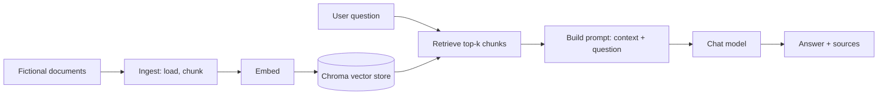

# Project Overview

## What this is

RAG Attack Lab is a deliberately vulnerable Retrieval-Augmented Generation (RAG) application, built for AI security education. It belongs to the same category as intentionally vulnerable training applications used to teach web security: a safe target you can attack, fix, and retest.

It runs locally, uses only fictional data, and never touches real systems.

## Why it exists

Most RAG security material stops at a single proof of concept. The goal here is the full loop a security engineer actually performs:

1. Build a vulnerable target.
2. Attack it and record findings with evidence.
3. Fix each finding.
4. Retest and measure the result.
5. Report it the way a professional pentest is reported.

Every finding is mapped to two public frameworks: the OWASP Top 10 for LLM Applications (2026) and MITRE ATLAS.

## Objectives

- A working, documented RAG pipeline with deliberately planted, documented weaknesses.
- A set of attacks against those weaknesses, each with evidence and an impact assessment.
- Fixes, retested, with before-and-after metrics (attack-block rate, false-positive rate, accuracy).
- An automated red-team harness that runs in CI.
- A written pentest report, a short demo, and a public write-up.

## How it works

The pipeline is deliberately small and readable, one responsibility per module.

- **Providers are swappable through environment variables.** The chat model is a local model served by Ollama by default, with an optional cloud provider and a deterministic fake provider for tests. Embeddings are a local model by default, with a deterministic offline embedding for tests.
- **Everything is local.** The vector store runs in-process and writes to a local folder. No server is started and no network is required to run the tests or the CI checks.

## Threat model, in brief

A RAG system trusts two things it should not fully trust: the user's question and the content of retrieved documents. The weaknesses this lab will plant and study live in that gap, including:

- Prompt injection, direct and through retrieved content (OWASP LLM01).
- Sensitive information disclosure from the index (OWASP LLM02).
- Exposure of hidden context such as the system prompt (OWASP LLM08).
- Vector and embedding weaknesses, including poisoning of the index (OWASP LLM09).

The full threat model is tracked as a dedicated document for the v1.0 milestone.

## Engineering practices

The repository is built to the standard a reviewer expects:

- Pinned dependencies and a documented, reproducible setup.
- Offline tests that need no model, no network, and no secrets.
- Continuous integration on every push and pull request that changes more than docs: tests on Linux (and on Windows for pull requests and a weekly run), linting, formatting, a dependency vulnerability audit, and the offline red-team harness.
- GitHub Actions pinned to exact commits, least-privilege tokens, and automated dependency updates.
- A security policy, a contribution guide, and decision records for notable choices.
- Known, reviewed dependency advisories are documented rather than hidden.

## Status and roadmap

The project is built in versioned phases. The clean baseline, the project scaffolding, and the CI harness are in place; the planted weaknesses, the attacks, the fixes, and the report follow.

See [ROADMAP.md](../ROADMAP.md) for the phase-by-phase plan and [SECURITY.md](../SECURITY.md) for the security policy. The final report structure is in [docs/report/OUTLINE.md](report/OUTLINE.md).
