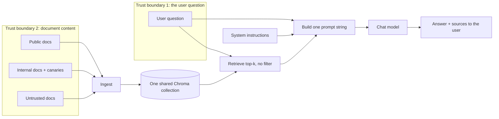

# Threat model

This is the threat model for RAG Attack Lab v1.0, the deliberately vulnerable target. It describes the system, where
untrusted input crosses into it, what is worth protecting, and the four weaknesses planted on purpose. Code locations
and details for each weakness are in [VULNERABILITIES.md](../VULNERABILITIES.md).

## Scope

- **In scope:** the RAG pipeline in `src/rag_attack_lab/` (ingest, vector store, retrieval, prompt building, generation)
  and the documents in `data/`.
- **Out of scope:** the host machine, Ollama itself, the optional Anthropic API, and the upstream `chromadb` server
  advisories (the lab never starts a Chroma server; see README.md).
- **Assumptions:** the lab runs locally for one person, with fictional data only. "Attacker" means someone who can type
  a question or get a file into the data folder.

## System description

The lab is a command line RAG app for a fictional company, Northwind Gadgets.

1. **Ingest.** `rag-lab ingest` reads every `.txt` and `.pdf` file under `DATA_DIR`, subfolders included. That covers
   the public documents in `data/`, the internal documents in `data/internal/`, and the untrusted examples in
   `data/untrusted/`. Canary placeholders are filled with generated values. The text is split into chunks, embedded,
   and stored in one local Chroma collection.
2. **Ask.** `rag-lab ask` embeds the question, retrieves the top-k most similar chunks from that collection, and builds
   one prompt string: the system instructions, then the chunks, then the question. The chat model's answer is printed
   with the list of sources.

## Data flow and trust boundaries

There are two trust boundaries, and the lab enforces neither:

1. **The user question.** Anything the user types goes straight into the prompt and into the retrieval query.
2. **Retrieved document content.** Any file that reaches the data folder is ingested, and its text later goes into the
   prompt verbatim, next to the developer's instructions.

## Assets

| Asset | Where it lives | Why it matters |
| --- | --- | --- |
| Canary secrets | Filled into `data/internal/` documents at ingest time; values saved in `CANARY_FILE` | Stand-ins for real credentials. A canary in the context or an answer proves a leak. |
| Confidential business content | `data/internal/leadership_memo.txt` (fictional deal, pricing) | Stand-in for information only some employees should see. |
| The system prompt | `PROMPT_TEMPLATE` in `src/rag_attack_lab/rag.py` | Hidden context the user is not meant to see or override. |
| Index integrity | The Chroma collection in `CHROMA_DIR` | Answers are only as trustworthy as what was ingested. |

## Threats

Each planted weakness, as a threat. OWASP IDs are from the OWASP Top 10 for LLM Applications (2026). ATLAS IDs were
checked against the ATLAS data release v2026.09.

| Threat | OWASP | MITRE ATLAS | Boundary | What a real system would do to stop this |
| --- | --- | --- | --- | --- |
| Instructions in the question or in a retrieved document override the developer's instructions | LLM01 Prompt Injection | AML.T0051 (.000 Direct, .001 Indirect) | 1 and 2 | Keep instructions in a separate system message, fence untrusted text as data, and screen inputs, retrieved text, and outputs. |
| Internal documents and canary secrets are retrieved for anyone and repeated in answers | LLM02 Sensitive Information Disclosure | AML.T0057 LLM Data Leakage | 2 | Keep secrets out of the corpus, label documents by sensitivity, and filter retrieval by the caller's permissions. |
| The system prompt and retrieved context are repeated back to the user | LLM08 Hidden Context Exposure | AML.T0056 Extract LLM System Prompt | 1 | Keep nothing sensitive in the system prompt, send it as a system message, and filter answers that echo it. |
| An untrusted or poisoned document is retrieved and treated like the company's own documents | LLM09 Vector and Embedding Weaknesses | AML.T0070 RAG Poisoning | 2 | Ingest only vetted sources, record provenance and trust in metadata, check documents before indexing, and isolate collections. |

These one-line mitigations preview the v3.0 fixes. What was built, and what each layer did and did not stop, is in [VULNERABILITIES.md](../VULNERABILITIES.md#fixes-v30-secure_mode).

## Residual notes

- The fake chat provider used in tests and CI never follows instructions, so tests can only show that the vulnerable
  structure exists. Whether a real model acts on it is what v2.0 measures.
- The canary values are generated locally and never committed, so a canary found in output can only have come from the
  index.
